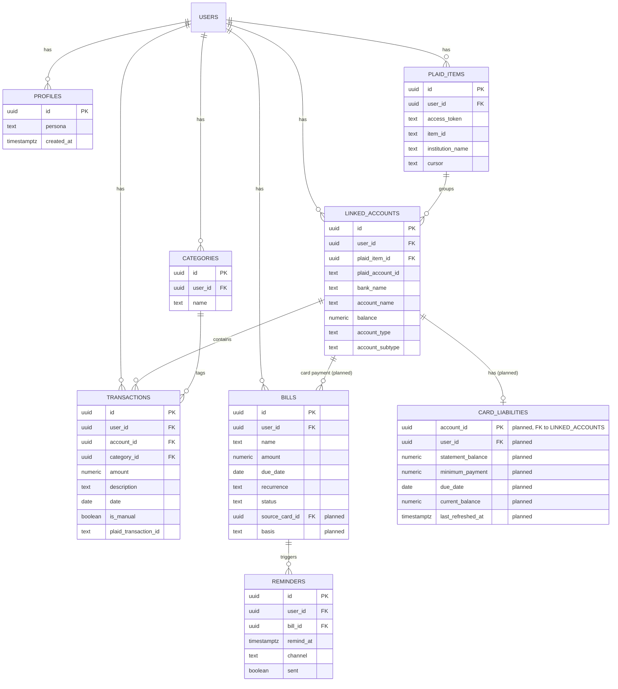

# Database diagram

The MVP #1 schema. Every table has Row Level Security so each person can only
see their own rows. GitHub renders the Mermaid diagram below as a picture.

Note: `USERS` is Supabase Auth's built-in `auth.users` table. Every other table
links to it by `user_id` (and `PROFILES` by `id`).

Items marked **planned** (`CARD_LIABILITIES`, and `BILLS.source_card_id` /
`BILLS.basis`) are the credit-card additions from
[ADR-0010](./adr/0010-credit-cards-plaid-liabilities.md); they ship in migration
`0005_card_liabilities` (ticket T52) and are not yet in the database.
