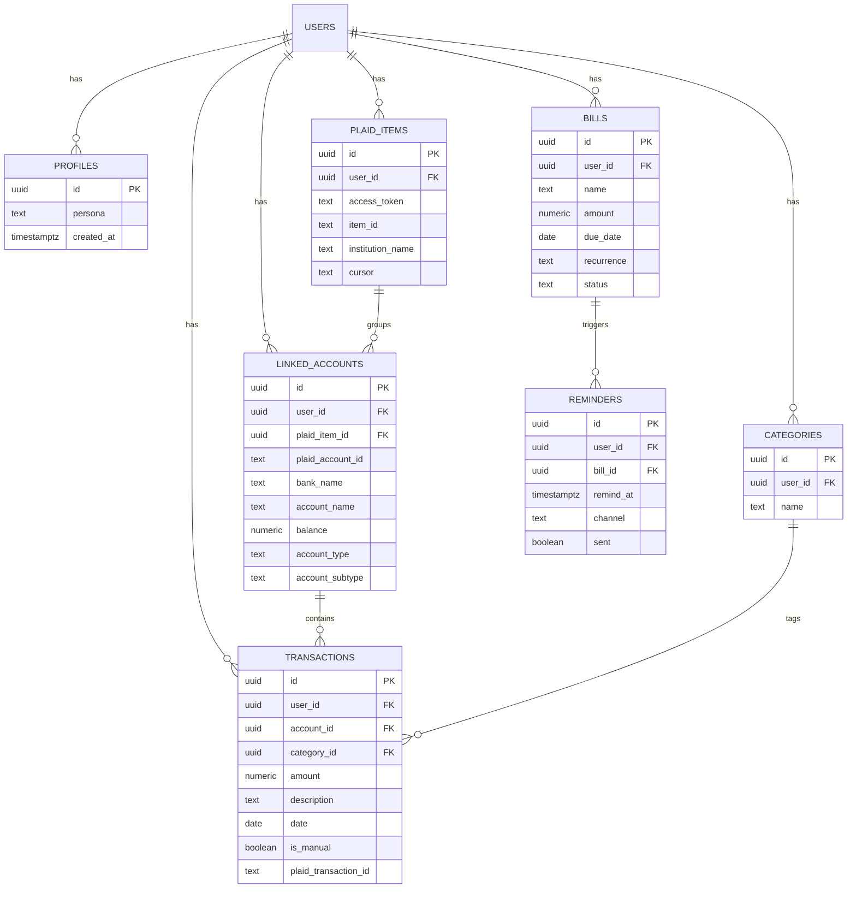

# Database diagram

The MVP #1 schema. Every table has Row Level Security so each person can only
see their own rows. GitHub renders the Mermaid diagram below as a picture.

Note: `USERS` is Supabase Auth's built-in `auth.users` table. Every other table
links to it by `user_id` (and `PROFILES` by `id`).
